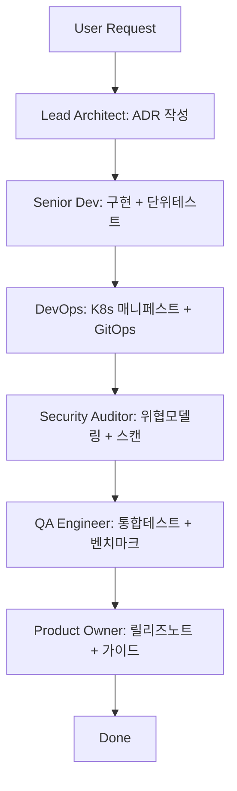

# Reasonix Agent Group — DeepSeek v4-flash on NVIDIA NIM

> **완전 자동화된 코딩 에이전트 그룹**  
> Reasonix + NVIDIA NIM(DeepSeek v4-flash) + Human-Role Agent Group (6 personas) + MCP Toolbox (khs0927)

---

## 🎯 아키텍처

```
┌─────────────────────────────────────────────────────────────┐
│                    ORCHESTRATOR                               │
│  ┌─────────────┐  ┌─────────────┐  ┌─────────────────────┐  │
│  │  Planner    │  │ Provisioner │  │ Agent-Group Manager │  │
│  └──────┬──────┘  └──────┬──────┘  └──────────┬──────────┘  │
│         │                │                    │              │
│         ▼                ▼                    ▼              │
│  ┌─────────────────────────────────────────────────────┐   │
│  │              EXECUTION LAYER                         │   │
│  │  ├─ Reasonix (Go binary, single binary)             │   │
│  │  ├─ NVIDIA NIM API (deepseek-ai/deepseek-v4-flash)  │   │
│  │  ├─ MCP Gateway (stdio/SSE/HTTP)                    │   │
│  │  ├─ All Skills (symlinked from /var/minis/skills)   │   │
│  │  └─ Human-Role Agents (6 personas)                  │   │
│  └─────────────────────────────────────────────────────┘   │
└─────────────────────────────────────────────────────────────┘
```

---

## 🤖 Human-Role Agent Group (6 personas)

| ID | 역할 | 전문 분야 | MCP 프로파일 |
|----|------|-----------|--------------|
| `lead-architect` | 리드 아키텍트 | 분산 시스템, 클라우드 네이티브, 보안 설계 | `architect` |
| `senior-dev` | 시니어 개발자 | Go/TypeScript/Python, TDD, 리팩토링 | `developer` |
| `devops-engineer` | 데브옵스 엔지니어 | Kubernetes, Terraform, GitOps, 관찰성 | `devops` |
| `security-auditor` | 보안 감사관 | OWASP, 공급망 보안, SBOM, 위협 모델링 | `security` |
| `product-owner` | 프로덕트 오너 | 비즈니스 가치, 사용자 스토리, 우선순위 | `product` |
| `qa-engineer` | QA 엔지니어 | 테스트 피라미드, 카오스 엔지니어링, 성능 벤치마크 | `qa` |

---

## 🚀 빠른 시작

### 1. 사전 준비

```bash
# 필수 환경변수 설정
export CLOUD_PROVIDER=hetzner          # 또는 digitalocean / existing
export SSH_PUBKEY_PATH=~/.ssh/id_ed25519.pub

# Minis 환경변수에 등록 필요:
# - DEEPSEEK_API_KEY (DeepSeek 공식 키, 선택사항)
# - NVIDIA_API_KEY (NVIDIA NIM 사용 시 필수)  
# - HCLOUD_TOKEN (Hetzner 사용 시)
# - SMITHERY_API_KEY (khs0927 MCP 사용 시)
```

### 2. 로컬 실행 (iSH/Minis)

```bash
# DS2API (브라우저 세션 토큰 필요 - 현재 비추천)
# NVIDIA NIM 직접 사용 권장

# Reasonix 바이너리 다운로드 및 설정
bash scripts/setup-reasonix-local.sh

# Agent Group 실행
bash scripts/start-agent-group.sh
```

### 3. 원격 배포 (완전 자동화)

```bash
# Hetzner VM 프로비저닝 + 전체 스택 배포
bash scripts/remote-deploy.sh

# 결과:
# - http://localhost:8080  → Reasonix Web UI
# - http://localhost:5001/v1  → NVIDIA NIM 호환 API (실제로는 NVIDIA 엔드포인트 프록시)
# - http://localhost:8081  → MCP Gateway
```

### 4. Kubernetes (k3s) 배포

```bash
# k3s 클러스터에 배포
kubectl apply -f k8s/reasonix-deployment.yaml
kubectl apply -f k8s/nvidia-secret.yaml
kubectl apply -f k8s/skills-configmap.yaml
```

---

## 📁 프로젝트 구조

```
reasonix-agent-group/
├── README.md
├── scripts/
│   ├── setup-reasonix-local.sh      # 로컬 Reasonix + NVIDIA NIM 설정
│   ├── start-agent-group.sh         # Agent Group 실행 진입점
│   ├── remote-deploy.sh             # 원격 VM 완전 자동 배포
│   ├── provision-vm.sh              # 클라우드 VM 프로비저닝
│   └── verify-deployment.sh         # 배포 검증
├── configs/
│   ├── reasonix-config.yaml         # Reasonix 설정 (NVIDIA NIM 연동)
│   ├── ds2api-config.json           # DS2API 설정 (참고용)
│   ├── mcp-gateway.yaml             # MCP Gateway 설정
│   └── agent-group-agents.yaml      # 6개 페르소나 정의
├── agent-group/
│   ├── orchestrator.py              # Python 오케스트레이터
│   └── pipeline.yaml                # 실행 파이프라인 정의
├── k8s/
│   ├── reasonix-deployment.yaml     # K8s Deployment
│   ├── nvidia-secret.yaml           # NVIDIA API Key Secret
│   ├── skills-configmap.yaml        # Skills ConfigMap
│   └── ingress.yaml                 # Ingress (선택)
└── docs/
    ├── ARCHITECTURE.md              # 아키텍처 상세
    ├── AGENT_PERSONAS.md            # 페르소나 상세 설명
    ├── MCP_INTEGRATION.md           # MCP 연동 가이드
    ├── DEPLOYMENT_GUIDE.md          # 배포 가이드
    └── TROUBLESHOOTING.md           # 문제 해결
```

---

## ⚙️ 핵심 설정

### Reasonix → NVIDIA NIM 연동 (`configs/reasonix-config.yaml`)

```yaml
model:
  provider: "openai"
  base_url: "https://integrate.api.nvidia.com/v1"
  api_key: "${NVIDIA_API_KEY}"
  model: "deepseek-ai/deepseek-v4-flash"
  temperature: 0.1
  max_tokens: 32768

cache:
  enabled: true
  prefix_cache: true

mcp:
  gateway:
    enabled: true
    port: 8081
  servers:
    - name: "reasonix-tools"
      transport: "stdio"
      command: ["reasonix", "mcp", "stdio"]
    - name: "skills"
      transport: "stdio"
      command: ["reasonix", "mcp", "skills", "--skills-dir", "/workspace/skills"]
    - name: "khs0927"
      transport: "http"
      url: "https://mcp.smithery.run/khs0927"
      headers:
        Authorization: "Bearer ${SMITHERY_API_KEY}"

agent_group:
  enabled: true
  config: "/workspace/agent-group/agents.yaml"
```

---

## 🔧 MCP Toolbox (khs0927) 연동

**100개 도구, 9개 서버** 자동 사용 가능:

| 서버 | 주요 도구 |
|------|-----------|
| `blackboxfoundry-livedatalink` | 주식/옵션/날씨/암호화폐/VIN/패키지 추적/법원/CVE/대학/제재 |
| `adamamer20-paper-search-mcp-openai` | arXiv/PubMed/bioRxiv/Google Scholar 논문 검색·다운로드 |
| `github` | 리포지토리 관리, 이슈/PR/액션 자동화 |
| `arxiv` | 논문 검색·조회 |
| `brave` / `tavily` / `exa` / `jina` | 웹 검색 |
| `vercel` / `vercel-grep` | 배포·코드 검색 |
| `huggingface` | 모델 카드·데이터셋 |
| `googledrive` / `googlesheets` | 구글 드라이브/시트 |
| `youtube` / `reddit` / `naver-search` | 미디어/커뮤니티 검색 |

자동 호출 예시 (Agent 내부에서):
```python
# khs0927-call search_toolbox '{"query":"kubernetes best practices","limit":5}'
# khs0927-call execute '{"code":"return await connections.github.github_repo({repo:\"owner/repo\"})"}'
```

---

## 📋 실행 파이프라인



각 단계는 **독립된 Reasonix sub-agent**로 실행되며, **MCP Gateway**를 통해 공통 툴 사용.

---

## 🔐 필수 시크릿 (환경변수 또는 K8s Secret)

| 변수명 | 용도 | 필수 여부 |
|--------|------|-----------|
| `NVIDIA_API_KEY` | NVIDIA NIM 인증 (DeepSeek v4-flash) | **필수** |
| `HCLOUD_TOKEN` | Hetzner VM 프로비저닝 | Hetzner 사용 시 |
| `SMITHERY_API_KEY` | khs0927 MCP Toolbox | MCP 사용 시 |
| `DEEPSEEK_API_KEY` | DeepSeek 공식 API (DS2API용) | DS2API 사용 시 |
| `GITHUB_TOKEN` | GitHub API (이슈/PR/액션) | GitHub 연동 시 |

---

## 🛠️ 개발자 도구

```bash
# 로그 실시간 확인
ssh user@host 'journalctl -u reasonix-agent-group -f'

# 세션 백업
scp user@host:~/workspace/.reasonix-session.json ./

# 새 태스크 주입
ssh user@host 'cd ~/workspace/agent-group && python3 -c "import orchestrator; orchestrator.inject_task(\"new feature\")"'

# 스케일 아웃
# agents.yaml에 새 에이전트 추가 후 systemctl restart reasonix-agent-group
```

---

## 📝 라이선스

MIT License — 자유롭게 사용, 수정, 배포 가능.

---

## 🤝 기여

1. Fork → Feature branch → PR
2. Agent persona 개선 환영
3. MCP 서버 추가·테스트 기여 환영

---

## 📞 지원

- Issues: GitHub Issues 사용
- Discussions: GitHub Discussions
- 관련 프로젝트: [Reasonix](https://github.com/Reasonix/Reasonix), [NVIDIA NIM](https://www.nvidia.com/en-us/ai-data-science/nim/), [khs0927 MCP](https://smithery.run/khs0927)